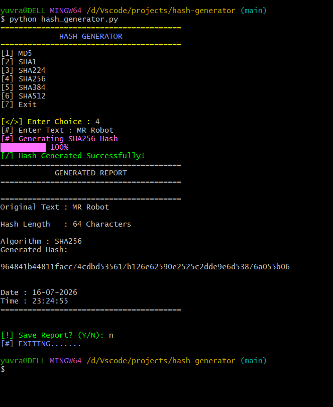

# Hash Generator

**An interactive Python exercise for hashing entered text.**

Generate a digest of UTF-8 text using MD5, SHA-1, SHA-224, SHA-256, SHA-384 or
SHA-512, display its length and timestamp, and optionally save a report.
This script does not read or stream files for hashing.

## Run

Python 3 and its standard library are sufficient.

```sh
git clone https://github.com/Yuvraj-26-k/Hash-Generator.git
cd Hash-Generator
python hash_generator.py
```

Choose an algorithm, enter non-secret sample text such as `hello`, and choose
whether to save a report. A safe output example is `hello-digest-demo.txt`;
the program adds `.txt` if needed, but can overwrite an existing destination.

## Security boundaries

MD5 and SHA-1 are legacy/educational options, not recommendations for new
security-sensitive designs. A plain digest is not password storage or
encryption. **Reports include the original entered text as well as its digest.**
Never enter passwords, tokens or confidential data into this demo.



This existing screenshot shows the interface; it is not a new benchmark or
test result. Current files are `hash_generator.py`, `Hash_generator.png` and
`README.md`.

## Development status

The digest calculations use `hashlib`; the interactive loop runs at import,
animations introduce artificial delay, and file-error handling needs work.
There is no first-party test suite. Priorities are separating UI from logic,
known-vector tests, optional omission of original text and create-only reports.
The original repository/history are retained; no consolidation occurs here.
